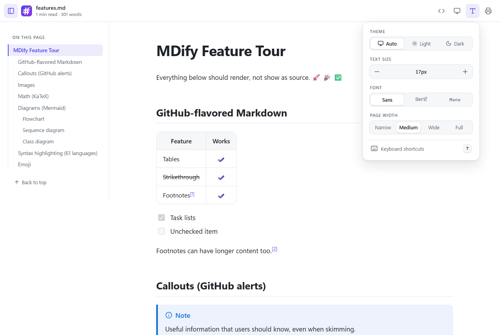
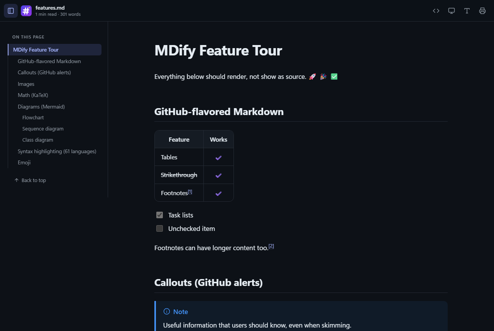
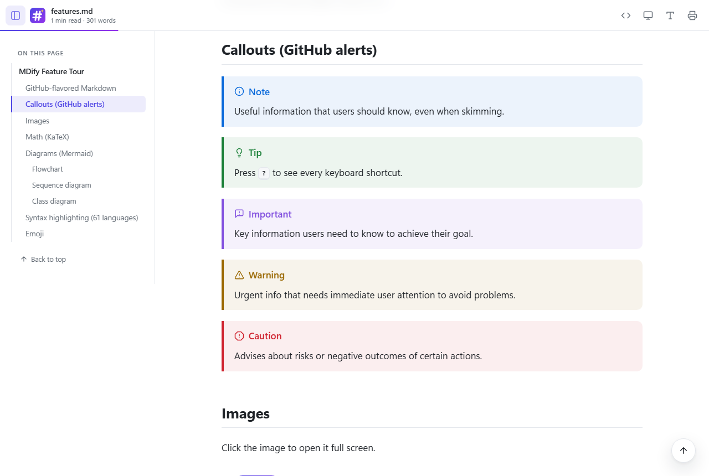
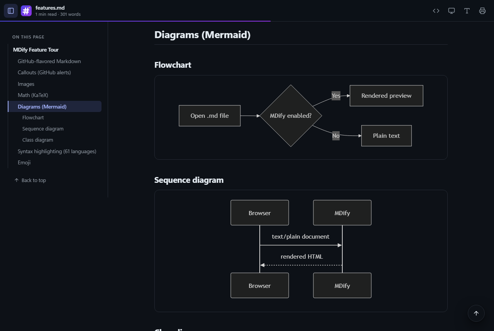
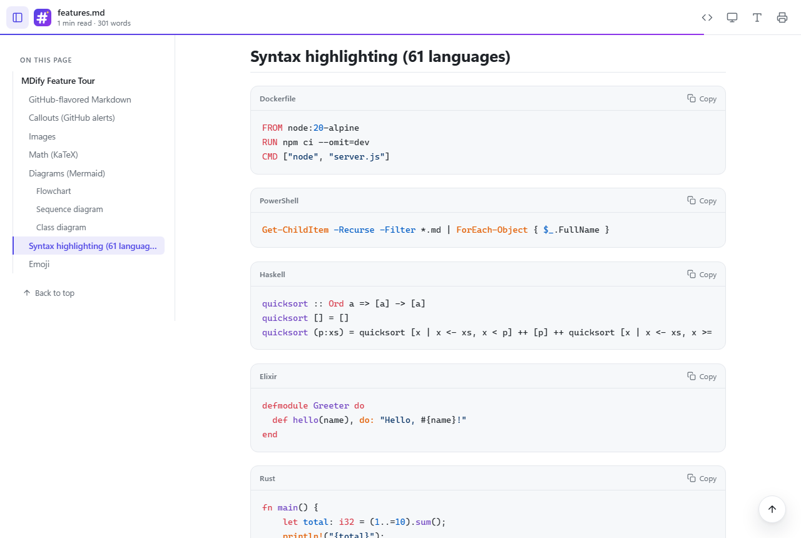

<p align="center">
  
</p>

<h1 align="center">MDify</h1>

<p align="center">
  <strong>Open any Markdown file in Chrome or Edge and read it beautifully rendered, not as raw text.</strong>
</p>

<p align="center">
  <a href="https://github.com/L337C0D3R/MDify/actions/workflows/ci.yml"></a>
  
  
  <a href="LICENSE"></a>
</p>

<p align="center">
  
</p>

## Features

**Rendering**

- **GitHub Flavored Markdown:** tables, task lists, strikethrough, autolinks and footnotes.
- **GitHub alerts:** `> [!NOTE]`, `[!TIP]`, `[!IMPORTANT]`, `[!WARNING]` and `[!CAUTION]` callouts.
- **Math with KaTeX:** inline `$E = mc^2$`, display `$$…$$` and ` ```math ` blocks.
- **Mermaid diagrams:** flowcharts, sequence, class and more. They follow the light/dark theme and load only on pages that use them.
- **Syntax highlighting** for 61 languages, with a language label and a one-click **Copy** button.
- **Emoji shortcodes** such as `:rocket:` `:tada:` `:white_check_mark:` (every GitHub shortcode).
- **YAML front matter** shown as a collapsible block.

**Reading experience**

- A clean, readable layout with a reading-time estimate and a progress bar.
- An "On this page" sidebar that tracks where you are. On small screens it becomes a slide-in drawer.
- **Reader settings** (the **Aa** button): Auto / Light / Dark theme, text size, Sans / Serif / Mono font and page width. Your choices are remembered.
- A highlighted **Raw** source view with line numbers.
- Full-screen image viewer, back-to-top button, copy-link heading anchors and remembered scroll position for each file.
- Keyboard shortcuts and print / save-as-PDF styles.

**Works where you need it**

- Local files (`file://`) and online files, for example raw GitHub URLs.
- Opens `.md`, `.markdown`, `.mdown`, `.mkd` and `.mkdn`.
- Shows files that servers send as `text/markdown` instead of downloading them.
- Leaves normal web pages alone, even if their URL ends in `.md` (for example GitHub's file view).

<p align="center">
  
  
  
  
</p>

## Installation

MDify isn't on the Chrome Web Store or Edge Add-ons yet. Install it from source in under a minute.

### Chrome

1. [Download the latest release](https://github.com/L337C0D3R/MDify/releases) and unzip it, or clone this repository.
2. Go to `chrome://extensions` and turn on **Developer mode** (top right).
3. Click **Load unpacked** and select the unzipped folder.
4. Click **Details** on MDify and turn on **Allow access to file URLs**. Without this, files on your computer won't render.

### Microsoft Edge

1. [Download the latest release](https://github.com/L337C0D3R/MDify/releases) and unzip it, or clone this repository.
2. Go to `edge://extensions` and turn on **Developer mode** (left sidebar).
3. Click **Load unpacked** and select the unzipped folder.
4. Click **Details** on MDify and turn on **Allow access to file URLs**.

Chrome or Edge **128 or later** is required.

## Usage

Open any Markdown file in the browser: drag it onto a tab, use *Open with → Chrome/Edge*, or follow a link to a raw `.md` file. MDify renders it automatically.

To see every feature, open [`sample/features.md`](sample/features.md).

### Keyboard shortcuts

| Key | Action |
| --- | --- |
| <kbd>T</kbd> | Show or hide the contents sidebar |
| <kbd>R</kbd> | Switch between rendered and raw source |
| <kbd>D</kbd> | Cycle the theme (Auto → Light → Dark) |
| <kbd>+</kbd> / <kbd>-</kbd> | Larger or smaller text |
| <kbd>G</kbd> | Back to top |
| <kbd>?</kbd> | Show all shortcuts |
| <kbd>Esc</kbd> | Close panels |

## Privacy and permissions

MDify works entirely on your device. It collects no data, has no analytics, and never loads code from the internet. It stores only your reader settings and the scroll position of recently opened files. See [PRIVACY.md](PRIVACY.md) for exactly what each permission is used for.

Markdown is sanitised with DOMPurify before it is displayed, so scripts inside a Markdown file never run. To report a security issue, see [SECURITY.md](SECURITY.md).

## Development

MDify has no build step: the repository folder *is* the extension. Load it unpacked as described above, edit the files, then click the reload icon on MDify's card.

```text
manifest.json      Manifest V3 definition
content.js         Detects plain-text Markdown, renders it and builds the reader UI
viewer.css         Reader styles (themes, layout, typography)
background.js      Service worker that injects Mermaid on demand
rules.json         Shows text/markdown responses instead of downloading them
popup.html/.js     Toolbar popup (theme, file-access check)
icons/             Logo sources (SVG) and PNG icons
lib/               Bundled third-party libraries
sample/            Markdown files that exercise every feature
scripts/           Packaging and manifest checks
```

Useful commands:

```sh
node scripts/check-manifest.mjs   # validate manifest.json and every referenced file
sh scripts/package.sh             # build dist/mdify-<version>.zip (macOS/Linux)
```

On Windows, run `powershell -ExecutionPolicy Bypass -File scripts/package.ps1` to build the zip.

See [CONTRIBUTING.md](CONTRIBUTING.md) for guidelines and the release process.

## Built with

[marked](https://github.com/markedjs/marked), [DOMPurify](https://github.com/cure53/DOMPurify), [highlight.js](https://github.com/highlightjs/highlight.js), [KaTeX](https://github.com/KaTeX/KaTeX), [Mermaid](https://github.com/mermaid-js/mermaid), [github-markdown-css](https://github.com/sindresorhus/github-markdown-css), [gemoji](https://github.com/github/gemoji) and [Lucide](https://github.com/lucide-icons/lucide) icons. See [THIRD_PARTY_NOTICES.md](THIRD_PARTY_NOTICES.md) for versions and licenses.

## License

[MIT](LICENSE) © 2026 L337C0D3R
