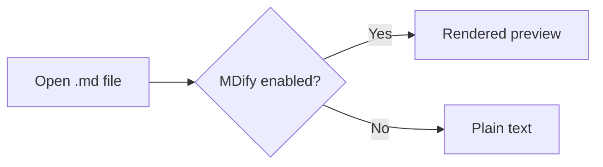
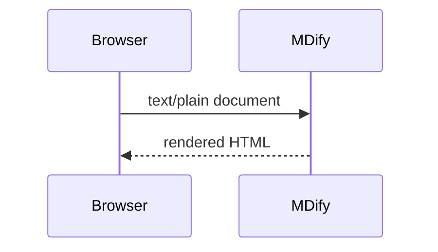
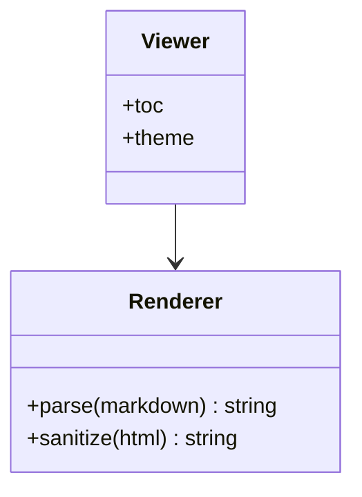

# MDify Feature Tour

Everything below should render, not show as source. :rocket: :tada: :white_check_mark:

## GitHub-flavored Markdown

| Feature | Works |
| --- | :---: |
| Tables | :heavy_check_mark: |
| ~~Strikethrough~~ | :heavy_check_mark: |
| Footnotes[^gfm] | :heavy_check_mark: |

- [x] Task lists
- [ ] Unchecked item

Footnotes can have longer content too.[^long]

[^gfm]: GitHub added footnote support in 2021.
[^long]: This footnote has **formatting** and a [link](https://example.com).

## Callouts (GitHub alerts)

> [!NOTE]
> Useful information that users should know, even when skimming.

> [!TIP]
> Press <kbd>?</kbd> to see every keyboard shortcut.

> [!IMPORTANT]
> Key information users need to know to achieve their goal.

> [!WARNING]
> Urgent info that needs immediate user attention to avoid problems.

> [!CAUTION]
> Advises about risks or negative outcomes of certain actions.

## Images

Click the image to open it full screen.


## Math (KaTeX)

Inline: the famous $E = mc^2$, and Euler's identity $e^{i\pi} + 1 = 0$.

Prices like $5 and $10 must stay plain text.

Display equation:

$$
\int_{-\infty}^{\infty} e^{-x^2}\,dx = \sqrt{\pi}
$$

A GitHub-style math block:

```math
\sum_{k=1}^{n} k = \frac{n(n+1)}{2}
```

## Diagrams (Mermaid)

### Flowchart



### Sequence diagram



### Class diagram



## Syntax highlighting (61 languages)

```dockerfile
FROM node:20-alpine
RUN npm ci --omit=dev
CMD ["node", "server.js"]
```

```powershell
Get-ChildItem -Recurse -Filter *.md | ForEach-Object { $_.FullName }
```

```haskell
quicksort :: Ord a => [a] -> [a]
quicksort [] = []
quicksort (p:xs) = quicksort [x | x <- xs, x < p] ++ [p] ++ quicksort [x | x <- xs, x >= p]
```

```elixir
defmodule Greeter do
  def hello(name), do: "Hello, #{name}!"
end
```

```rust
fn main() {
    let total: i32 = (1..=10).sum();
    println!("{total}");
}
```

## Emoji

:smile: :heart: :+1: :sparkles: :fire: — and an unknown code stays as text: :not_a_real_emoji:
